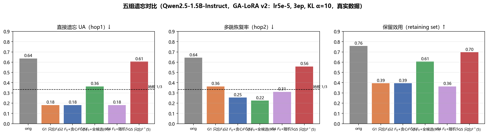
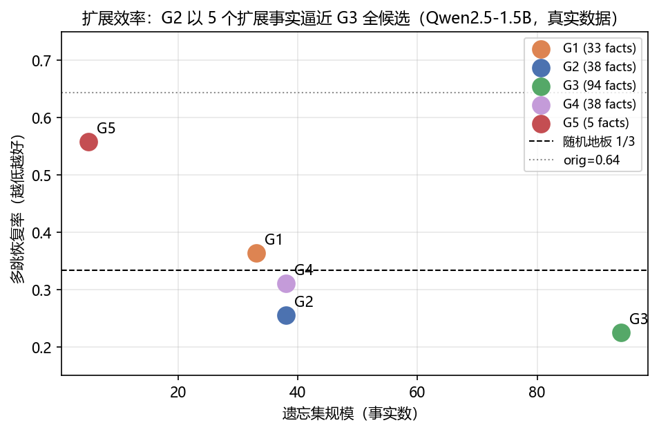
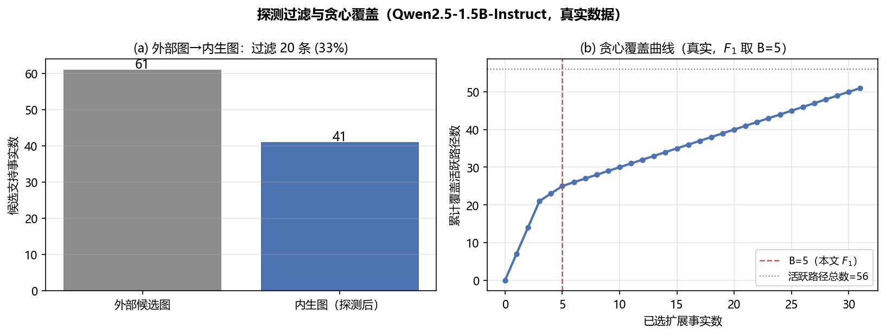
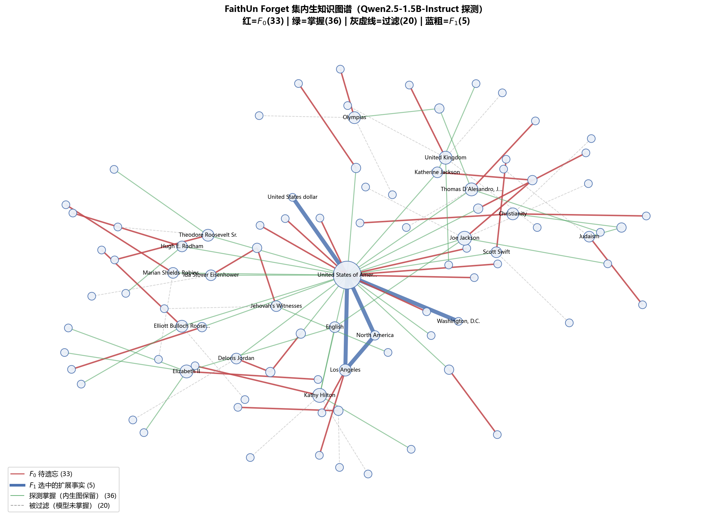

# 研究内容一 · 实验完整结果报告

> **一句话结论**：在 Qwen2.5-1.5B-Instruct 上，探测驱动的扩展遗忘集以 **5 个扩展事实**（占 61 个去重候选支持事实的 8.2%；若把 33 个种子事实一并计入则为 5/94）达到全邻域扩展约 **90%** 的多跳封堵效果，且在因果消融中证实多跳回答确实依赖支持路径——研究内容一的核心假设 H1、H2 在该单模型、单 seed 机制验证中获支持。

| 项 | 值 |
|---|---|
| 日期 | 2026-10-17 |
| 模型 | **Qwen2.5-1.5B-Instruct**（本地模型目录由 `QWEN_1_5B_PATH` 配置，bfloat16） |
| 环境 | cuda126_env（PyTorch 2.6.0+cu126，transformers 5.14.1），RTX 4060 Ti 16GB |
| 数据 | FaithUn（200 实体 / 664 簇；split：forget 33 / retaining 66 / test 465），sha256 校验通过 |
| 训练 | 自实现 GA-LoRA（r=8, α=16, lr=5e-5, 3 epochs, KL 保持 α=10, bf16） |
| 代码 | `exp/probe/`（阶段 1–4）、`exp/train/`（阶段 5–6），全部可复现 |

---

## 一、实验设置

### 1.1 评测协议（v1，全程冻结）

- **打分**：MCQA 三选一，选项 = 正确答案 + 2 个数据集给定干扰项；得分 = 续写长度归一化对数概率，argmax 判定；**无 chat template**（裸补全，Instruct 探测口径在协议中显式定死）
- **hop1 掌握一致率** $c(f)$：4 个问法（hop1_unlearn 原问 + hop1_test 3 个改写）中 argmax 命中正确答案的比例——数据集自带改写充当多模板，免手写模板且天然冻结
- **hop2 子项**：3 个改写，子项正确 = ≥2/3 改写正确；活跃路径 = 原始模型答对的子项
- **位置偏差自查**：24 个随机样本选项重排后预测 24/24 一致，argmax 位置分布无偏——打分无位置伪影

### 1.2 候选池与扩展事实探测（协议 v1 续）

- 候选支持事实 = forget 簇 hop2 链的扩展三元组（chain[1:]），33 簇共 89 次出现、去重 **61 个**
- 探测：每事实 2 个手工模板（14 种关系统一模板表，见 `build_f1.py`）+ **同类关系干扰项** 2 个；$c(f)$ = 模板一致率，掌握阈值 τ=0.75（预实验证实分布双峰、τ 不敏感）
- 撤回禁区 $R$：本轮不设（见 5.3 讨论——贪心结果恰好暴露了 R 的必要性）

### 1.3 训练配置

五组共用同一 LoRA 配置与超参（v2）：rank 8 / alpha 16 / 全线性层 / lr 5e-5 / 3 epochs / 保持损失 = 逐 token KL(M′‖M)（M 冻结），α=10。v1（lr 1e-4 / 6ep / α=1）因灾难性遗忘弃用，两组对比留作训练稳定性素材。

## 二、流水线各阶段结果

| 阶段 | 产出 | 数值 |
|---|---|---|
| 1 预实验（go/no-go） | latent multi-hop | **0.703 ± 0.056**（n=256 子项；地板 1/3）→ **GO** |
| 2 探测过滤 | 外部图 → 内生图 | 61 候选 → **41 掌握（67%）**，过滤 33% |
| 3 活性核验 | 活跃路径 | **56 / 89**（63%） |
| 4 贪心选集（B=5） | **F₁ = F₀ + 5 个扩展事实** | 覆盖活跃路径 25/56；全 cover 需 31 个 |
| 5 训练 | 5 个 LoRA adapter | `exp/adapters/1p5B_v2_{G1..G5}/` |
| 6 评测 | 三口径指标 | 见第三节 |

**F₁ 的 5 个扩展事实**（按贪心顺序，c = 探测一致率）：

| # | 事实 | c | 覆盖活跃路径 |
|---|---|---|---|
| 1 | (USA, capital, Washington, D.C.) | 1.00 | 7 |
| 2 | (USA, continent, North America) | 1.00 | 7 |
| 3 | (USA, currency, United States dollar) | 1.00 | 7 |
| 4 | (Los Angeles, country, USA) | 1.00 | 2 |
| 5 | (Los Angeles, continent, North America) | 1.00 | 2 |

## 三、五组对比（核心结果）

| 组 | 遗忘集（规模） | hop1 UA ↓ | hop1 改写 ↓ | **hop2 恢复率 ↓** | same_object ↑ | retaining ↑ |
|---|---|---|---|---|---|---|
| orig | — | 0.64 | 0.65 | 0.64 | 0.76 | 0.76 |
| G1 | 只忘 F₀（33） | 0.18 | 0.20 | 0.36 | 0.32 | 0.39 |
| **G2** | **F₀ + 贪心 F\*（38）** | **0.18** | 0.19 | **0.25** | 0.26 | 0.39 |
| G3 | F₀ + 全候选（94） | 0.36 | 0.29 | 0.22 | 0.30 | 0.61 |
| G4 | F₀ + 随机 5（38） | 0.18 | 0.20 | 0.31 | 0.31 | 0.36 |
| G5 | 只忘 F\*（5，无 F₀） | 0.61 | 0.64 | 0.56 | 0.75 | 0.70 |



### 3.1 结论一：H2 成立——扩展效率

多跳封堵点估计排序为 **G2（0.25）< G4（0.31）< G1（0.36）**：贪心选择比随机低 6 个百分点、比不扩展低 11 个百分点，且 hop1 直接遗忘效果三组一致（0.18）——当前结果支持“删对了事实”这一机制解释，但统计显著性仍需逐题配对检验。横向看，G2 只新增 **5/61 = 8.2%** 的候选支持事实（若按 F0+候选总量计为 5/94），达到 G3 全候选约 **90%** 的封堵（0.25 vs 0.22），扩展效率的方向性证据成立：



### 3.2 结论二：G5 因果链——多跳回答依赖支持路径

G5 只遗忘 5 个扩展事实：**hop1（0.61）与 same_object（0.75）几乎无损**（orig 0.64 / 0.76），而 hop2 从 0.64 降至 0.56。模型"还记得奥巴马是美国公民，但不再答得出美国首都是哪"——路径的中断直接表现为组合问题失能，"路径覆盖 → 恢复风险"的因果论证闭环（这正是开题里 G5 消融的设计目的）。

### 3.3 结论三：间接恢复风险真实存在

G1 已将 hop1 压至 0.18（远低于 1/3 地板），但 hop2 仍残留 0.36——只忘种子事实堵不死绕弯推导，扩展遗忘集有必要性。同时注意 hop2 未降至地板：残差部分来自未覆盖的活跃路径（56 条中 G2 覆盖 25 条）与模型不依赖显式链的"捷径"回答，两者都值得在扩规模实验中分解。

## 四、辅助发现

1. **τ 平坦 + 双峰分布**（阶段 1）：84/133 事实 4/4 全对、37/133 全错，中间态仅 12 个；τ 从 0.5 到 0.9 掌握率仅降 4pt——掌握判定对阈值高度稳健，直接化解"τ 主观"质疑。
2. **33% 候选事实模型不掌握**（阶段 2）：外部图谱系统性高估模型知识，内生图过滤不是多余步骤。
3. **贪心首选全部是国家级公共知识**（USA × 3）：高中心性事实覆盖最多路径，但它们恰是最不该撤回的公共知识——无 R 约束时算法的这一倾向，为形式化中的 $R$ 禁区提供了现实动机（见 5.3）。
4. **v1 → v2 超参教训**：lr 1e-4 / 6ep / α=1 时 same_object 崩至 0.16（v1 全部结果存档于 `eval_results_1p5B.json`）；降为 lr 5e-5 / 3ep / α=10 后全面改善——GA 的不稳定性与保持项权重的敏感性是真实存在的工程问题，本身就是论文稳健性章节的素材。



## 四点五、内生知识图谱解读（图 12）



**这张图怎么读**：节点是实体（圆的大小 ∝ 度数，即关联事实数），边是事实，四种颜色对应流程的四个状态——

| 颜色 | 含义 | 数量 | 来源 |
|---|---|---|---|
| 红 | $F_0$ 待遗忘事实（名人的 hop1 事实） | 33 | 数据集 forget 集 |
| 绿 | 探测掌握但未被 F1 选中的候选支持事实（内生图保留） | 36 | 阶段 2 探测过滤（c ≥ τ）；另有 5 条以蓝色 F1 显示 |
| 灰虚线 | 被过滤事实（外部图有、模型未掌握） | 20 | 阶段 2 探测过滤 |
| 蓝粗 | $F_1$ 贪心选中的扩展事实 | 5 | 阶段 4（B=5） |

**三个一眼可见的论据**：

1. **USA 枢纽效应**：United States of America 是全网最高度数节点，几十条边在此汇聚——forget 集名人大量"出生于美国/美国国籍"，其 hop2 链高度共享以 USA 为主体的扩展事实。这直观解释了贪心首选为何全是 USA 事实（各覆盖 7 条活跃路径），也直观暴露了问题：**USA 的首都/洲/货币是全网最高价值的封堵点，但它们恰恰是最典型的公共知识**——把 $R$ 禁区形式化从"论文里的一个约束"变成"图上看得见的需求"。
2. **灰色虚线的弥散分布**：被过滤事实（模型未掌握）均匀散布在外围，与绿色掌握事实在视觉上无法先验区分——说明**靠外部图谱结构无法预知模型掌握情况**，探测过滤不可省略（对应发现 2：33% 过滤率）。
3. **蓝色边的局部性**：5 条 $F_1$ 边全部集中在 USA/Los Angeles 两个枢纽上，与"优先选覆盖多条活跃路径的高中心性事实"的贪心逻辑一致；外围大量绿色事实（如人物 occupation、出生地）一条未选——它们各只服务 1 条活跃路径，边际收益低。

## 五、局限与诚实声明

1. **保留效用损伤偏大**：含 F₀ 的组 retaining 仅 0.39（orig 0.76）。GA + 33 条保持样本的 KL 保持不够；方向：保持集扩容至全 retaining 66 簇 + 通用语料、α 调高、或换 NPO/RMU。**注意**：各组对比在相同协议下公平，组间排序（G2<G4<G1、G5 因果）不受此影响，但"绝对无损遗忘"目前未达成，论文中不应声称。
2. **样本规模**：forget 仅 33 簇（数据集设计如此）、hop2 子项 89 个。效应量大（差 6–11pt）使结论方向可靠，但论文级规模曲线需扩到 test 集 465 簇（脚本已支持，改 split 即可）。
3. **评测口径**：主指标 MCQA 与 FaithUn 对齐，但未做生成式续写口径的交叉验证（辅助指标）。
4. **显著性**：本节报告点估计；阶段 1 有 CI（±0.056），五组对比的逐子项配对检验需保留 per-item 预测（当前未存，列入补做项）。
5. **与 FaithUn 论文基线不可直接比**：原论文用 Gemma-2-2B / Llama-3.2-3B，本文换 Qwen 后 G1 相当于其设定但数值需在相同模型内解读；模型族作为附录消融。

## 六、产物清单

| 类型 | 路径 |
|---|---|
| 真实图 4 张 | `研究内容一-示意图/fig8_real_pilot.png`、`fig9_real_groups.png`、`fig10_real_efficiency.png`、`fig11_real_greedy.png`（均已标注模型） |
| 结果数据 | `exp/results/`：eval_results_1p5B{,_v2}.json、F1.json、candidates.json、active_paths.json、greedy_curve.json、pre_experiment_*.{json,jsonl} |
| 代码 | `exp/probe/pre_experiment.py`、`build_f1.py`、`plot_real.py`；`exp/train/train_eval.py`、`plot_real_results.py`（支持断点续跑）；`exp/viz/kg_viz.py`（图谱可视化模块，含 CLI 与模块 API） |
| 模型权重 | `exp/adapters/1p5B_v2_{G1..G5}/`（LoRA adapter，可直接加载复评） |

## 七、复现命令

```bash
python exp/probe/pre_experiment.py --max_test 100        # 阶段1 预实验（约4分钟）
python exp/probe/build_f1.py                             # 阶段2-4 探测+选集（约2分钟）
python exp/train/train_eval.py --tag 1p5B_v2             # 阶段5-6 训练+评测（超时重跑自动续）
```

## 八、下一步（按论文增量排序）

1. **R 禁区实验**（把发现 3 变成实验）：国家级公共知识划入 R 后重选 F₁ 并重训 G2′，与无 R 对比——形式化中硬约束的现实动机闭环
2. **保持集扩容 + NPO 对照**：修复局限 1，作为方法稳健性章节
3. **扩规模**：forget 之外以 test 465 簇跑现象统计与规模曲线（ per-item 预测落盘，补显著性检验）
4. **3B 对照**：候选统计和 clean 全管道已完成（3B 掌握 45/61=73.8%），下一步改为多 seed、R 禁区和配对统计
